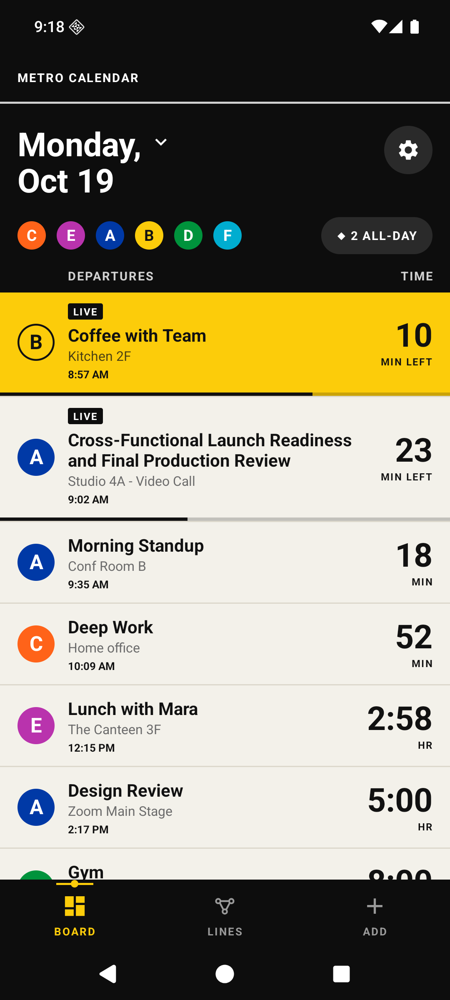
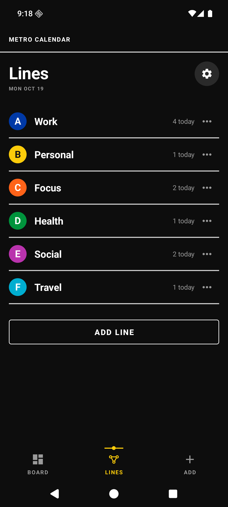
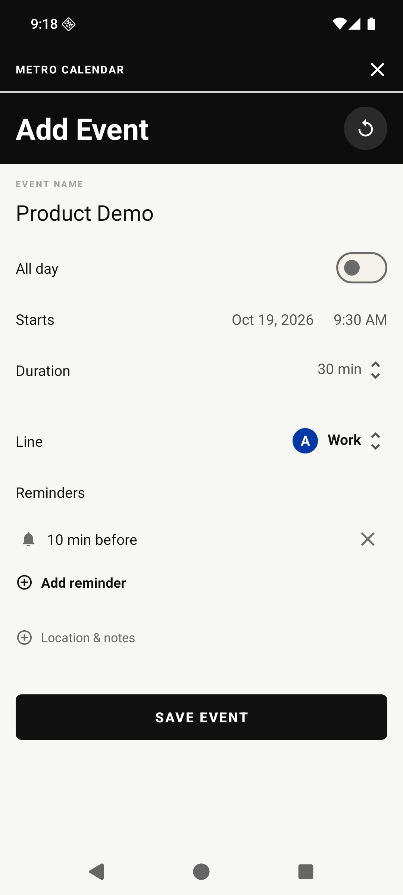
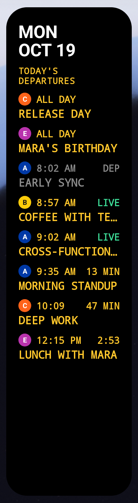
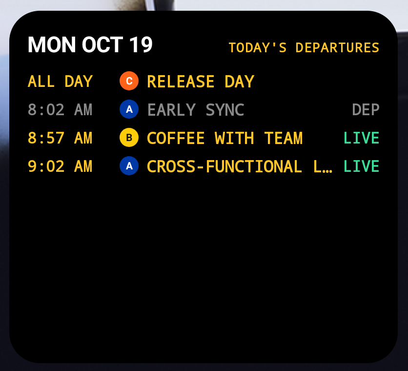
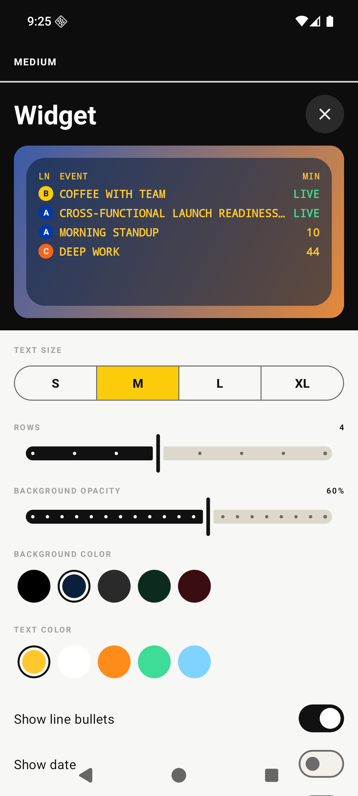
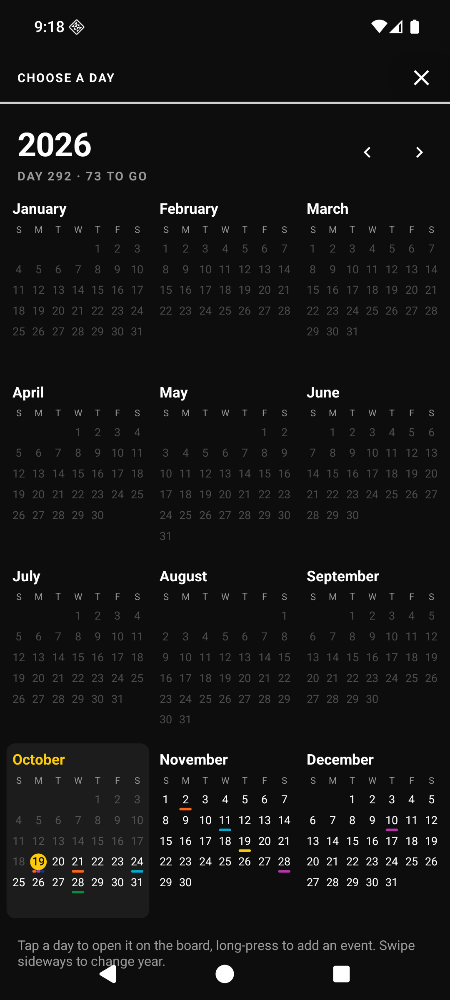
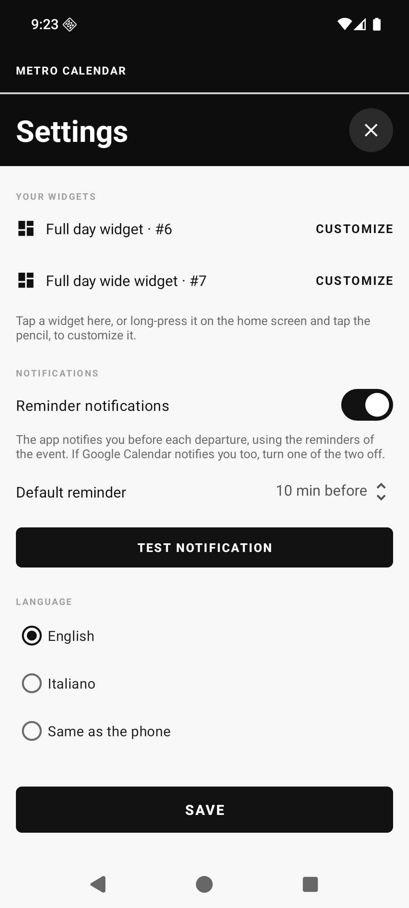
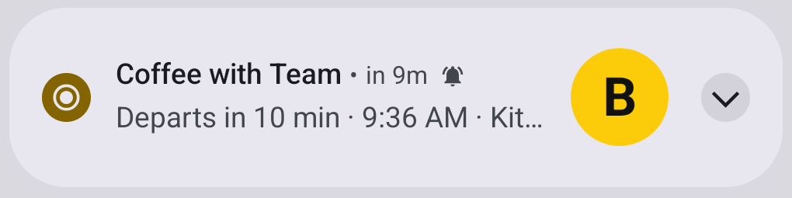

# Metro calendar

Calendario per Android in stile segnaletica della metropolitana: la giornata diventa un **tabellone delle partenze**, i calendari diventano **linee** con il loro pallino colorato, e sulla home ci sono widget a LED che contano i minuti alla prossima partenza.

<p align="center">
  
  
  
</p>

## Ispirazione

L'app è una **versione per Android ispirata** al video [**"I rebuilt the calendar"**](https://youtu.be/ZuF_BVLqMc0) di Joe Cirillo, che reinventa il calendario come un tabellone della metro. Interfaccia e widget riprendono le idee del video; il codice è scritto da zero per Android. Il progetto non è affiliato all'autore del video.

## Download

Scarica l'ultimo `MetroCalendar.apk` dalla pagina [Releases](https://github.com/Alfree125/metro-calendar/releases/latest) e aprilo sul telefono. Android ti chiederà di consentire l'installazione da fonti sconosciute.

Supporta da **Android 6.0** (API 23) ad **Android 17** (API 37).

Al primo avvio l'app chiede l'accesso al calendario. Su Android 13 e successivi, la prima volta che salvi un evento con un promemoria, chiede anche il permesso per le notifiche.

## Funzioni

- **Board**: il tabellone del giorno. L'evento in corso è giallo con l'etichetta LIVE e la barra di avanzamento, gli altri mostrano un grande conto alla rovescia ("18 MIN", "1:58 HR"). Gli eventi già partiti si nascondono, quelli di tutto il giorno stanno nella pillola "◆ ALL-DAY". Si cambia giorno scorrendo di lato.
- **Anno intero**: toccando la data si apre l'anno a colpo d'occhio, con i colori delle linee sotto ogni giorno.
- **Lines**: ogni calendario del telefono è una linea con codice (la lettera nel pallino), nome e colore modificabili. Si possono aggiungere linee nuove o nasconderle dal tabellone.
- **Add Event**: nome, tutto il giorno, inizio, durata, linea, fino a 5 promemoria, luogo e note.
- **Promemoria**: notifiche in stile metro ("Departs in 10 min · 9:36 AM · Kitchen 2F") con il pulsante per rimandare.
- **Widget** in cinque formati, personalizzabili uno per uno (dimensione del testo, righe, colore e trasparenza dello sfondo, colore del testo, cosa mostrare).
- **Personalizzazione**: nome dell'app, sei icone in stile metro e un'icona sulla home con nome e immagine a scelta (anche una foto).
- **Lingua**: inglese, come nel video, oppure italiano.

Gli eventi stanno nel **calendario di sistema**, quindi si vedono anche in Google Calendar e nelle altre app. L'app non usa Internet.

## Widget

| Formato | Contenuto |
| --- | --- |
| Piccolo 2×2 | Le prossime quattro partenze |
| Medio 4×2 | Le prossime partenze, in largo |
| Grande 4×4 | Data e tabellone del giorno |
| Giornata 2×4 | Tutta la giornata in colonna, con orari, LIVE e partiti |
| Giornata 4×2 | Tutta la giornata, una riga per evento |

<p align="center">
  
  
</p>

<p align="center">
  
  
  
</p>

<p align="center">
  
</p>

## Compilare

Serve Android SDK con piattaforma 37 e JDK 17:

```bash
./gradlew assembleDebug
```

Per la versione firmata `./gradlew assembleRelease` legge la chiave da un file `.properties` fuori dal repository (vedi `app/build.gradle.kts`); senza chiave firma con quella di debug.

I layout dei widget si generano con `strumenti/genera_widget.py`:

```bash
python strumenti/genera_widget.py app/src/main/res
```

## Note

- Le notifiche partono dai promemoria del calendario di sistema. Se le ricevi anche da Google Calendar, puoi spegnere quelle dell'app nelle impostazioni.
- Android non permette alle app di cambiare il proprio nome nell'elenco app: il nome personalizzato vale per l'app, i widget e l'icona creata sulla home.
- Su Android 6 e 7 i widget si aggiungono dal menu della home; il pulsante nelle impostazioni funziona da Android 8.
